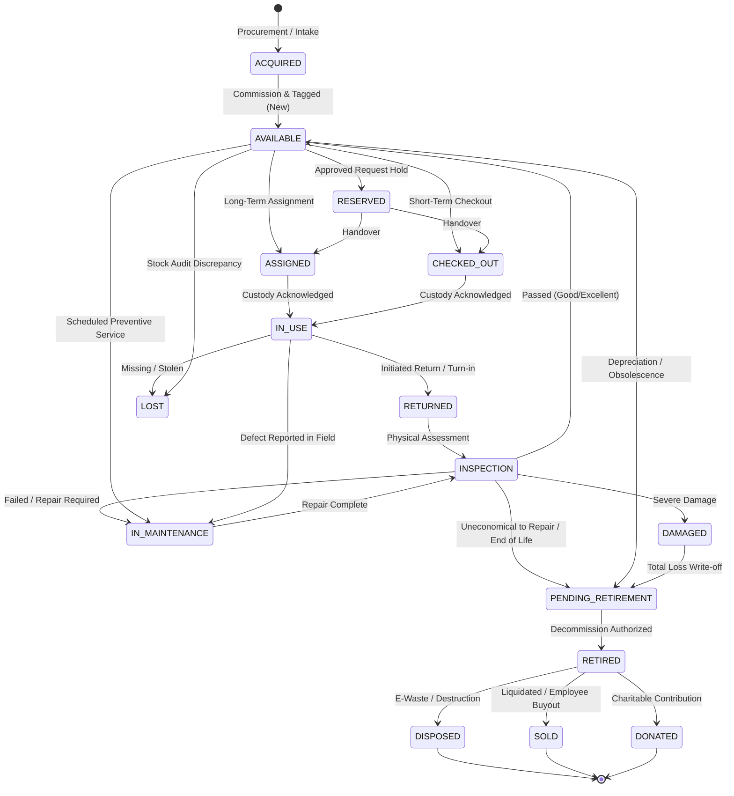

# Asset Lifecycle & State Machine Specification
## Asset Management Portal

**Document Version:** 1.0.0  
**Status:** Approved Architectural Specification  
**Scope:** Asset State Transitions, Custody Protocols & Ledger Auditing  

---

## 1. Lifecycle Overview & State Machine Diagram

Every physical and digital asset follows a strictly governed state machine from procurement to final disposition. State transitions cannot occur ad-hoc; every transition requires validation of business prerequisites, permission verification, and the generation of an append-only transaction ledger entry in the `Transactions` sheet.

---

## 2. State Definitions & Semantics

| State Code | Category | Description | Operational Custody |
|---|---|---|---|
| `ACQUIRED` | Intake | Received from vendor; invoice logged; pending tagging and inspection. | In Logistics / IT Intake |
| `AVAILABLE` | Active Stock | Tagged, inspected, cataloged, and resting in an inventory location ready for deployment. | IT Storage / Inventory Room |
| `RESERVED` | Staged | Allocated against an approved hardware request; cannot be assigned to another user. | Staging Area / IT Shelf |
| `ASSIGNED` | Custody Handover | Allocated to a named staff member or department; awaiting user acknowledgment. | Pending Custody Transfer |
| `CHECKED_OUT` | Short-Term Active | Temporarily checked out (e.g., loaner laptop, camera, projector) with expected return date. | Borrower Custody |
| `IN_USE` | Active Operational | Currently deployed and in active daily operation by custodian. | Named User or Department |
| `RETURNED` | Return Intake | Returned by user to IT; awaiting formal physical check-in inspection. | IT Turn-in Bin |
| `INSPECTION` | Quality Gate | Being evaluated for physical condition, data wiping, and hardware diagnostics. | IT Workbench |
| `IN_MAINTENANCE` | Service | Currently under scheduled servicing, warranty RMA, or corrective hardware repair. | Internal Lab or Vendor |
| `DAMAGED` | Defective | Structurally or functionally defective; unusable in current state. | Quarantined Storage |
| `LOST` | Investigation | Missing during inventory count or reported stolen/lost by employee. | Unaccounted |
| `PENDING_RETIREMENT` | Staged Terminal | Approved for retirement; data wipe verified; awaiting disposal, auction, or donation. | Decommission Staging |
| `RETIRED` | Terminal | De-inventoried; book value written down; removed from operational roster. | Terminal Vault |
| `DISPOSED` | Terminal Archive | Physically destroyed or processed via certified e-waste recycling vendor. | Terminal Archive |
| `SOLD` | Terminal Archive | Transferred to third-party purchaser or employee buyout. | Terminal Archive |
| `DONATED` | Terminal Archive | Transferred to recognized educational or non-profit organization. | Terminal Archive |

---

## 3. State Transition Matrix & Enforcement Rules

| From State | To State | Trigger / Action | Allowed Permissions | Prerequisites & Invariant Checks | Automatic Side Effects |
|---|---|---|---|---|---|
| `ACQUIRED` | `AVAILABLE` | Initial Tagging | `assets:create`, `assets:edit` | Unique `asset_tag` assigned; physical condition evaluated; location assigned. | Create `ACQUISITION` transaction; set condition to `NEW`. |
| `AVAILABLE` | `ASSIGNED` | Long-Term Allocation | `assets:checkout` | Valid `user_id` or `department_id` provided; asset condition is `FAIR` or better. | Create active `Assignments` record; create `ASSIGN` transaction; send notification to user. |
| `AVAILABLE` | `CHECKED_OUT` | Short-Term Checkout | `assets:checkout` | Valid `user_id` provided; `expected_return_date` specified. | Create `Assignments` record; create `CHECK_OUT` transaction; schedule return reminders. |
| `ASSIGNED` / `CHECKED_OUT` | `IN_USE` | Custody Acknowledgment | `assets:view:assigned` | Digital acknowledgment checkbox confirmed by assigned user. | Update `Assignments.custody_agreement_signed = TRUE`. |
| `IN_USE` | `RETURNED` | Initiate Return | `assets:checkin` | Returned equipment handed over to authorized custodian. | Record `actual_return_date`; create `CHECK_IN` transaction. |
| `RETURNED` | `INSPECTION` | Intake Review | `assets:checkin` | Initiated by Asset Manager or Technician. | Update status; route to inspection queue. |
| `INSPECTION` | `AVAILABLE` | Inspection Passed | `assets:checkin` | Condition evaluated as `EXCELLENT`, `GOOD`, or `FAIR`; sanitization/wipe completed. | Clear `assigned_user_id`; set to storage `location_id`; create `CONDITION_UPDATE` transaction. |
| `INSPECTION` | `IN_MAINTENANCE`| Defect Found | `maintenance:manage` | Ticket title and description logged; vendor or internal tech assigned. | Create `Maintenance` ticket; create `SEND_TO_MAINTENANCE` transaction. |
| `IN_MAINTENANCE` | `INSPECTION` | Repair Completed | `maintenance:manage` | Maintenance ticket marked `COMPLETED`; repair costs and invoice attached. | Update `Maintenance` status; create `RETURN_FROM_MAINTENANCE` transaction. |
| Any Active | `LOST` | Mark Missing | `assets:archive` | Mandatory incident report note detailing loss circumstances. | Set `assigned_user_id = NULL`; trigger audit notification to Super Admin. |
| Any Active | `PENDING_RETIREMENT` | Decommission Stage | `assets:archive` | Asset meets retirement threshold (age, damage, unrepairable cost). | Freeze asset from requests/checkouts; flag for financial write-off. |
| `PENDING_RETIREMENT` | `DISPOSED` | E-Waste Destruction | `assets:archive` | Disposal certificate document attached; Super Admin approval recorded. | Mark `is_archived = TRUE`; update disposal date; create terminal audit log. |
| `PENDING_RETIREMENT` | `SOLD` | Asset Sale | `assets:archive` | Sale invoice and sale amount recorded in ledger. | Mark `is_archived = TRUE`; record proceeds in transaction notes. |
| `PENDING_RETIREMENT` | `DONATED` | Asset Donation | `assets:archive` | Donation receipt document attached to asset record. | Mark `is_archived = TRUE`; log non-profit recipient in transaction notes. |

---

## 4. Custody Transfer Protocols

### 4.1 Check-Out Protocol (Short-Term & Long-Term)
1. **Identification:** Asset Manager locates asset via search or scans physical QR code on asset label.
2. **Eligibility Verification:** System verifies asset status is `AVAILABLE` and condition is operational.
3. **Assignee Selection:** Asset Manager searches and selects employee from active user registry.
4. **Checkout Parameters:**
   - Assignment Type: `LONG_TERM` (indefinite) or `TEMPORARY_CHECKOUT` (short-term).
   - Expected Return Date: Required for temporary checkout; optional for long-term.
   - Accessory Checklist: Charger, cables, adapter, protective bag, peripherals.
   - Handover Condition Sign-off: Record current condition (`EXCELLENT`, `GOOD`, `FAIR`).
5. **Execution:**
   - Status updates to `ASSIGNED` or `CHECKED_OUT`.
   - New row appended to `Assignments`.
   - New row appended to `Transactions`.
   - Notification sent to recipient email with asset tag, model, serial number, and custody agreement link.

### 4.2 Check-In & Return Protocol
1. **Intake Scan:** Custodian returns gear to IT. Manager scans asset QR code.
2. **Custody Matching:** System retrieves active assignment record and displays expected accessories checklist.
3. **Physical Inspection:**
   - Functional Check: Powers on, display intact, ports operational.
   - Cosmetic Check: Scratches, dents, physical damage.
   - Return Condition Assessment: Manager selects updated condition.
4. **Resolution Routing:**
   - **If Pristine/Good:** Manager selects inventory shelf location -> Asset status becomes `AVAILABLE`.
   - **If Broken/Damaged:** Manager flags defect -> Status becomes `IN_MAINTENANCE` or `DAMAGED` -> Ticket opened automatically.
5. **Ledger Closure:**
   - Active `Assignments` record updated with `actual_return_date`, `return_condition`, and status `RETURNED`.
   - New row appended to `Transactions` documenting handover and returned condition.

---

## 5. Maintenance Sub-Workflow

Maintenance operations exist in three operational modes:
1. **Preventive Maintenance (PM):** Scheduled on a recurring calendar (e.g., HVAC servicing, server battery replacement). Asset temporarily shifts from `AVAILABLE` to `IN_MAINTENANCE`.
2. **Corrective Repair:** Incident-driven. An employee reports a fault or inspection reveals a hardware defect. The asset transitions from `IN_USE` or `INSPECTION` into `IN_MAINTENANCE`.
3. **Vendor Warranty Claim (RMA):** Asset is shipped back to OEM vendor. `Maintenance` record tracks vendor RMA number, tracking ID, and expected turnaround date.

---

## 6. End-of-Life & Decommissioning Compliance

- **No Destructive Physical Deletion:** Assets are never deleted via SQL `DELETE` or sheet row deletion. They transition to terminal states (`DISPOSED`, `SOLD`, `DONATED`) and have `is_archived = TRUE`.
- **Financial Audit Trail:** The last transaction preserves the asset's purchase price, cumulative depreciation, residual scrap/sale value, and net book gain/loss.
- **Data Sanitization Proof:** Before any IT computing equipment reaches `DISPOSED`, `SOLD`, or `DONATED`, a data erasure certificate must be linked in `Documents`.
