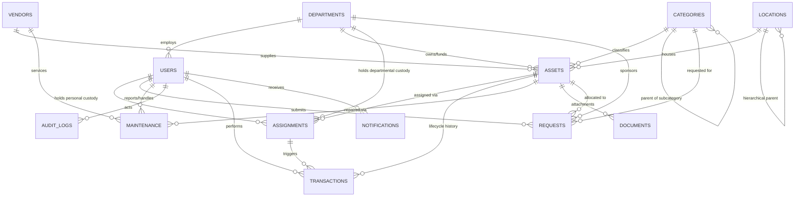

# Database & Data Model Specification
## Asset Management Portal

**Document Version:** 2.0.0  
**Status:** Approved & Finalized Implementation-Ready Schema  
**Primary Storage Engine (Phase 1):** Google Sheets Tabular Workbook (14 Dedicated Sheets)  
**Target Migration Engine (Phase 2):** PostgreSQL Relational Database  

---

## 1. Architectural Data Principles & Reconciled Product Decisions

1. **Sequential Human-Readable IDs:**  
   Every primary entity utilizes a standardized, zero-padded sequential string identifier (e.g., `AST-000001`, `USR-000001`, `DEP-000001`). Sequence state is managed via the `Settings` sheet and guarded server-side against concurrent race conditions.
2. **Dual-Mode Asset Custody (User vs Department):**  
   Assets and assignments support both individual custody (e.g., Laptop assigned to Rahul Sharma) and departmental custody (e.g., Projector assigned to Computer Science Department, Lab equipment assigned to AIML Department). No fake individual proxy user is ever required for shared organizational gear.
3. **Operational Depreciation (No Accounting Subsystem in V1):**  
   The schema records `purchase_cost`, `purchase_date`, `useful_life` (in months), and estimated `current_value`. It intentionally does not implement automated accounting depreciation calculations or tax ledger routines in V1.
4. **Structured Category-Specific Specifications (`custom_fields`):**  
   Category-specific technical specifications (e.g., CPU/RAM for laptops, IMEI for phones, Sensor/Lens for cameras, Resolution/Lumens for projectors) are stored in a sanitized, structured JSON string column named `custom_fields`. Fixed column explosion is strictly prevented.
5. **Configurable Authentication Identity:**  
   Users map to future Google OAuth via `auth_provider_id` (Google `sub` claim). Organization email domains and allowed lists are stored in `Settings` rather than hardcoded into table definitions. Passwords are never stored.
6. **Non-Destructive Append-Only History:**  
   Operational events (checkouts, check-ins, transfers, condition updates, repairs, retirements) are immutably written to `Transactions`. Historical rows are never edited or overwritten.
7. **Soft-Deletion & Lifecycle Archiving:**  
   Physical deletion (`DELETE`) is prohibited for business records. Assets transition through controlled lifecycle statuses (`AVAILABLE` -> `ASSIGNED` -> `RETIRED` -> `DISPOSED`) with soft-delete flags (`is_archived = TRUE`).
8. **Stable Relational Integrity:**  
   Foreign-key relations are referenced strictly via immutable alphanumeric IDs (`asset_id`, `user_id`, `department_id`, `location_id`), never mutable names or descriptions.

---

## 2. Entity Relationship Diagram (ERD) & Cardinality



### Cardinality Summary
- **Departments (1) : (N) Users** — One department has zero or many users; a user belongs to zero or one department.
- **Departments (1) : (N) Assets** — One department owns/funds zero or many assets (cost-center relationship).
- **Users (1) : (N) Assignments** — One user can hold multiple asset assignments over time.
- **Departments (1) : (N) Assignments** — One department can hold multiple asset assignments over time.
- **Assets (1) : (N) Assignments** — An asset has many historical assignments, but at most ONE `ACTIVE` assignment at any given time.
- **Assets (1) : (N) Transactions** — An asset has an append-only historical log of multiple lifecycle events.
- **Categories (1) : (N) Categories** — Hierarchical parent/child relationship (e.g., "Computing" -> "Laptops").
- **Locations (1) : (N) Locations** — Multi-tier physical location hierarchy (Site -> Building -> Floor -> Room -> Storage Area).

---

## 3. Google Sheets Workbook Specification (14 Dedicated Sheets)

### 3.1 Sheet: `Assets`
- **Purpose:** Primary master inventory catalog representing physical and digital assets.
- **Primary Key:** `asset_id` (Pattern: `AST-^[0-9]{6}$`)
- **Row 1 Header Order:**
  `asset_id`, `asset_tag`, `name`, `category_id`, `subcategory`, `brand`, `model`, `serial_number`, `description`, `status`, `condition`, `custody_type`, `department_id`, `location_id`, `current_user_id`, `current_assignment_id`, `purchase_date`, `purchase_cost`, `useful_life_months`, `current_value`, `currency`, `vendor_id`, `invoice_reference`, `warranty_start`, `warranty_expiry`, `custom_fields`, `is_archived`, `created_at`, `updated_at`, `archived_at`

| Column Header | Data Type | Req? | Default | Allowed Values / Format | Validation Rule | Reference / FK | System Gen? | Mutable? | Indexed? |
|---|---|:---:|---|---|---|---|:---:|:---:|:---:|
| `asset_id` | String | **Yes** | None | `AST-000001` to `AST-999999` | Regex: `^AST-[0-9]{6}$`, Unique | PK | **Yes** | No | **Yes** |
| `asset_tag` | String | **Yes** | None | Alphanumeric (e.g., `TAG-10042`) | Min 3, Max 50 chars, Unique | None | No | **Yes** | **Yes** |
| `name` | String | **Yes** | None | Free text (Max 150 chars) | Non-empty string | None | No | **Yes** | **Yes** |
| `category_id` | String | **Yes** | None | `CAT-000001` | Must exist in `Categories` | `Categories.category_id` | No | **Yes** | **Yes** |
| `subcategory` | String | No | `""` | Free text (Max 80 chars) | Optional descriptive subcategory | None | No | **Yes** | No |
| `brand` | String | **Yes** | None | Free text (Max 80 chars) | Non-empty string | None | No | **Yes** | **Yes** |
| `model` | String | No | `""` | Free text (Max 100 chars) | Optional model string | None | No | **Yes** | **Yes** |
| `serial_number` | String | No | `""` | Alphanumeric (Max 100 chars) | Unique per brand/model if present | None | No | **Yes** | **Yes** |
| `description` | String | No | `""` | Free text (Max 1000 chars) | Formula-sanitized text | None | No | **Yes** | No |
| `status` | Enum | **Yes** | `ACQUIRED` | `ACQUIRED`, `AVAILABLE`, `RESERVED`, `ASSIGNED`, `CHECKED_OUT`, `IN_MAINTENANCE`, `LOST`, `DAMAGED`, `PENDING_RETIREMENT`, `RETIRED`, `DISPOSED`, `SOLD`, `DONATED` | Must match valid status enum | None | **Yes** | **Yes** | **Yes** |
| `condition` | Enum | **Yes** | `NEW` | `NEW`, `EXCELLENT`, `GOOD`, `FAIR`, `POOR`, `DAMAGED` | Must match valid condition enum | None | No | **Yes** | **Yes** |
| `custody_type` | Enum | **Yes** | `NONE` | `NONE`, `USER`, `DEPARTMENT` | Must match custody enum | None | **Yes** | **Yes** | **Yes** |
| `department_id` | String | No | `""` | `DEP-000001` | Must exist in `Departments` if set | `Departments.department_id` | No | **Yes** | **Yes** |
| `location_id` | String | **Yes** | None | `LOC-000001` | Must exist in `Locations` | `Locations.location_id` | No | **Yes** | **Yes** |
| `current_user_id`| String | No | `""` | `USR-000001` | Required if `custody_type == USER` | `Users.user_id` | **Yes** | **Yes** | **Yes** |
| `current_assignment_id` | String | No | `""` | `ASN-000001` | Links active assignment | `Assignments.assignment_id` | **Yes** | **Yes** | **Yes** |
| `purchase_date` | Date | No | `""` | ISO Date: `YYYY-MM-DD` | Valid calendar date <= today | None | No | **Yes** | No |
| `purchase_cost` | Decimal | No | `0.00` | Non-negative numeric | `>= 0.00`, 2 decimal places | None | No | **Yes** | No |
| `useful_life_months`| Integer | No | `36` | Integer `>= 0` | Whole number months | None | No | **Yes** | No |
| `current_value` | Decimal | No | `0.00` | Non-negative numeric | `>= 0.00`, estimated book value | None | No | **Yes** | No |
| `currency` | String | **Yes** | `USD` | ISO 4217 code (e.g., `USD`, `INR`) | Exactly 3 uppercase letters | None | No | **Yes** | No |
| `vendor_id` | String | No | `""` | `VEN-000001` | Must exist in `Vendors` if set | `Vendors.vendor_id` | No | **Yes** | **Yes** |
| `invoice_reference` | String | No | `""` | Alphanumeric (Max 80 chars) | Optional procurement invoice ID | None | No | **Yes** | No |
| `warranty_start`| Date | No | `""` | ISO Date: `YYYY-MM-DD` | Valid calendar date | None | No | **Yes** | No |
| `warranty_expiry`| Date | No | `""` | ISO Date: `YYYY-MM-DD` | `>= warranty_start` if both present | None | No | **Yes** | **Yes** |
| `custom_fields` | JSON | **Yes** | `{}` | Valid JSON string | Max 5000 chars, valid JSON object | None | No | **Yes** | No |
| `is_archived` | Boolean | **Yes** | `FALSE` | `TRUE`, `FALSE` | Boolean string representation | None | **Yes** | **Yes** | **Yes** |
| `created_at` | DateTime | **Yes** | None | ISO 8601 UTC | Valid timestamp string | None | **Yes** | No | No |
| `updated_at` | DateTime | **Yes** | None | ISO 8601 UTC | Valid timestamp string | None | **Yes** | **Yes** | No |
| `archived_at` | DateTime | No | `""` | ISO 8601 UTC or empty | Valid timestamp if archived | None | **Yes** | **Yes** | No |

---

### 3.2 Sheet: `Users`
- **Purpose:** Organizational employee directory, administrative roles, and authentication claims.
- **Primary Key:** `user_id` (Pattern: `USR-^[0-9]{6}$`)
- **Row 1 Header Order:**
  `user_id`, `email`, `first_name`, `last_name`, `phone`, `role`, `department_id`, `job_title`, `status`, `auth_provider_id`, `created_at`, `updated_at`

| Column Header | Data Type | Req? | Default | Allowed Values / Format | Validation Rule | Reference / FK | System Gen? | Mutable? | Indexed? |
|---|---|:---:|---|---|---|---|:---:|:---:|:---:|
| `user_id` | String | **Yes** | None | `USR-000001` to `USR-999999` | Regex: `^USR-[0-9]{6}$`, Unique | PK | **Yes** | No | **Yes** |
| `email` | String | **Yes** | None | Valid email address | Unique, standard email regex | None | No | **Yes** | **Yes** |
| `first_name` | String | **Yes** | None | Max 80 chars | Non-empty string | None | No | **Yes** | No |
| `last_name` | String | **Yes** | None | Max 80 chars | Non-empty string | None | No | **Yes** | No |
| `phone` | String | No | `""` | Max 30 chars | E.164 phone or formatted string | None | No | **Yes** | No |
| `role` | Enum | **Yes** | `STAFF` | `SUPER_ADMIN`, `ADMIN`, `ASSET_MANAGER`, `DEPARTMENT_MANAGER`, `STAFF`, `VIEWER` | Valid role enum | None | No | **Yes** | **Yes** |
| `department_id` | String | No | `""` | `DEP-000001` | Must exist in `Departments` if set | `Departments.department_id` | No | **Yes** | **Yes** |
| `job_title` | String | No | `""` | Max 100 chars | Free text | None | No | **Yes** | No |
| `status` | Enum | **Yes** | `ACTIVE` | `ACTIVE`, `SUSPENDED`, `DEACTIVATED` | Valid user status enum | None | No | **Yes** | **Yes** |
| `auth_provider_id` | String | No | `""` | String (Google `sub` claim) | Unique across users when present | None | **Yes** | **Yes** | **Yes** |
| `created_at` | DateTime | **Yes** | None | ISO 8601 UTC | Valid timestamp string | None | **Yes** | No | No |
| `updated_at` | DateTime | **Yes** | None | ISO 8601 UTC | Valid timestamp string | None | **Yes** | **Yes** | No |

---

### 3.3 Sheet: `Categories`
- **Purpose:** Equipment taxonomy, useful life defaults, and custom field specification templates.
- **Primary Key:** `category_id` (Pattern: `CAT-^[0-9]{6}$`)
- **Row 1 Header Order:**
  `category_id`, `name`, `code`, `description`, `parent_category_id`, `default_useful_life_months`, `spec_schema_json`, `status`, `created_at`, `updated_at`

| Column Header | Data Type | Req? | Default | Allowed Values / Format | Validation Rule | Reference / FK | System Gen? | Mutable? | Indexed? |
|---|---|:---:|---|---|---|---|:---:|:---:|:---:|
| `category_id` | String | **Yes** | None | `CAT-000001` to `CAT-999999` | Regex: `^CAT-[0-9]{6}$`, Unique | PK | **Yes** | No | **Yes** |
| `name` | String | **Yes** | None | Max 100 chars | Unique, non-empty string | None | No | **Yes** | **Yes** |
| `code` | String | **Yes** | None | Uppercase alphanumeric (e.g., `LAP`) | 2-10 uppercase chars, Unique | None | No | **Yes** | **Yes** |
| `description` | String | No | `""` | Max 500 chars | Free text | None | No | **Yes** | No |
| `parent_category_id` | String | No | `""` | `CAT-000001` | Must exist in `Categories` if set | `Categories.category_id` | No | **Yes** | **Yes** |
| `default_useful_life_months` | Integer | **Yes** | `36` | Integer `>= 1` | Default depreciation window | None | No | **Yes** | No |
| `spec_schema_json`| JSON | **Yes** | `{}` | JSON schema string | Defines allowed custom field keys | None | No | **Yes** | No |
| `status` | Enum | **Yes** | `ACTIVE` | `ACTIVE`, `INACTIVE` | Valid status enum | None | No | **Yes** | **Yes** |
| `created_at` | DateTime | **Yes** | None | ISO 8601 UTC | Valid timestamp string | None | **Yes** | No | No |
| `updated_at` | DateTime | **Yes** | None | ISO 8601 UTC | Valid timestamp string | None | **Yes** | **Yes** | No |

---

### 3.4 Sheet: `Departments`
- **Purpose:** Organizational units, cost centers, and departmental custody holders.
- **Primary Key:** `department_id` (Pattern: `DEP-^[0-9]{6}$`)
- **Row 1 Header Order:**
  `department_id`, `name`, `code`, `description`, `manager_user_id`, `budget_code`, `status`, `created_at`, `updated_at`

| Column Header | Data Type | Req? | Default | Allowed Values / Format | Validation Rule | Reference / FK | System Gen? | Mutable? | Indexed? |
|---|---|:---:|---|---|---|---|:---:|:---:|:---:|
| `department_id` | String | **Yes** | None | `DEP-000001` to `DEP-999999` | Regex: `^DEP-[0-9]{6}$`, Unique | PK | **Yes** | No | **Yes** |
| `name` | String | **Yes** | None | Max 100 chars | Unique, non-empty string | None | No | **Yes** | **Yes** |
| `code` | String | **Yes** | None | Uppercase alphanumeric (e.g., `ENG`) | 2-10 uppercase chars, Unique | None | No | **Yes** | **Yes** |
| `description` | String | No | `""` | Max 500 chars | Free text | None | No | **Yes** | No |
| `manager_user_id`| String | No | `""` | `USR-000001` | Must exist in `Users` if set | `Users.user_id` | No | **Yes** | **Yes** |
| `budget_code` | String | No | `""` | Max 50 chars | Cost center code string | None | No | **Yes** | No |
| `status` | Enum | **Yes** | `ACTIVE` | `ACTIVE`, `INACTIVE` | Valid status enum | None | No | **Yes** | **Yes** |
| `created_at` | DateTime | **Yes** | None | ISO 8601 UTC | Valid timestamp string | None | **Yes** | No | No |
| `updated_at` | DateTime | **Yes** | None | ISO 8601 UTC | Valid timestamp string | None | **Yes** | **Yes** | No |

---

### 3.5 Sheet: `Locations`
- **Purpose:** Multi-level hierarchical physical storage and operational locations.
- **Hierarchy Structure:** `SITE` -> `BUILDING` -> `FLOOR` -> `ROOM` -> `STORAGE_AREA` -> `RACK` / `DESK`
- **Primary Key:** `location_id` (Pattern: `LOC-^[0-9]{6}$`)
- **Row 1 Header Order:**
  `location_id`, `name`, `location_type`, `parent_location_id`, `code`, `address`, `status`, `created_at`, `updated_at`

| Column Header | Data Type | Req? | Default | Allowed Values / Format | Validation Rule | Reference / FK | System Gen? | Mutable? | Indexed? |
|---|---|:---:|---|---|---|---|:---:|:---:|:---:|
| `location_id` | String | **Yes** | None | `LOC-000001` to `LOC-999999` | Regex: `^LOC-[0-9]{6}$`, Unique | PK | **Yes** | No | **Yes** |
| `name` | String | **Yes** | None | Max 100 chars | Non-empty string | None | No | **Yes** | **Yes** |
| `location_type` | Enum | **Yes** | None | `SITE`, `BUILDING`, `FLOOR`, `ROOM`, `STORAGE_AREA`, `RACK`, `DESK` | Must match location type enum | None | No | **Yes** | **Yes** |
| `parent_location_id` | String | No | `""` | `LOC-000001` | Must exist in `Locations` if set; no circular hierarchy | `Locations.location_id` | No | **Yes** | **Yes** |
| `code` | String | No | `""` | Alphanumeric (e.g., `HQ-B1-R102`) | Max 50 chars, unique if set | None | No | **Yes** | **Yes** |
| `address` | String | No | `""` | Max 250 chars | Physical site street address | None | No | **Yes** | No |
| `status` | Enum | **Yes** | `ACTIVE` | `ACTIVE`, `INACTIVE` | Valid status enum | None | No | **Yes** | **Yes** |
| `created_at` | DateTime | **Yes** | None | ISO 8601 UTC | Valid timestamp string | None | **Yes** | No | No |
| `updated_at` | DateTime | **Yes** | None | ISO 8601 UTC | Valid timestamp string | None | **Yes** | **Yes** | No |

---

### 3.6 Sheet: `Assignments`
- **Purpose:** Active and historical custody contracts between an asset and a user OR department.
- **Primary Key:** `assignment_id` (Pattern: `ASN-^[0-9]{6}$`)
- **Custody Integrity Invariant:** Exactly one of `user_id` or `department_id` must be populated, strictly governed by `custody_type`.
- **Row 1 Header Order:**
  `assignment_id`, `asset_id`, `custody_type`, `user_id`, `department_id`, `assignment_type`, `assigned_at`, `expected_return_at`, `returned_at`, `assigned_condition`, `returned_condition`, `assigned_by`, `returned_by`, `status`, `notes`, `created_at`, `updated_at`

| Column Header | Data Type | Req? | Default | Allowed Values / Format | Validation Rule | Reference / FK | System Gen? | Mutable? | Indexed? |
|---|---|:---:|---|---|---|---|:---:|:---:|:---:|
| `assignment_id` | String | **Yes** | None | `ASN-000001` to `ASN-999999` | Regex: `^ASN-[0-9]{6}$`, Unique | PK | **Yes** | No | **Yes** |
| `asset_id` | String | **Yes** | None | `AST-000001` | Must exist in `Assets` | `Assets.asset_id` | No | No | **Yes** |
| `custody_type` | Enum | **Yes** | None | `USER`, `DEPARTMENT` | Must match custody enum | None | No | No | **Yes** |
| `user_id` | String | No | `""` | `USR-000001` | **Required if custody_type == USER**; Must be empty if DEPARTMENT | `Users.user_id` | No | No | **Yes** |
| `department_id` | String | No | `""` | `DEP-000001` | **Required if custody_type == DEPARTMENT**; Must be empty if USER | `Departments.department_id` | No | No | **Yes** |
| `assignment_type` | Enum | **Yes** | `LONG_TERM` | `LONG_TERM`, `TEMPORARY_CHECKOUT` | Valid assignment type enum | None | No | No | **Yes** |
| `assigned_at` | DateTime | **Yes** | None | ISO 8601 UTC | Valid timestamp string | None | **Yes** | No | **Yes** |
| `expected_return_at` | Date | No | `""` | ISO Date: `YYYY-MM-DD` | Required for `TEMPORARY_CHECKOUT`; `>= assigned_at` | None | No | **Yes** | **Yes** |
| `returned_at` | DateTime | No | `""` | ISO 8601 UTC | Set when status becomes `RETURNED` | None | **Yes** | **Yes** | No |
| `assigned_condition` | Enum | **Yes** | None | `NEW`, `EXCELLENT`, `GOOD`, `FAIR`, `POOR`, `DAMAGED` | Condition at handover | None | No | No | No |
| `returned_condition` | Enum | No | `""` | `NEW`, `EXCELLENT`, `GOOD`, `FAIR`, `POOR`, `DAMAGED` | Condition upon return inspection | None | **Yes** | **Yes** | No |
| `assigned_by` | String | **Yes** | None | `USR-000001` | User performing allocation | `Users.user_id` | **Yes** | No | **Yes** |
| `returned_by` | String | No | `""` | `USR-000001` | User accepting return | `Users.user_id` | **Yes** | **Yes** | No |
| `status` | Enum | **Yes** | `ACTIVE` | `ACTIVE`, `RETURNED`, `OVERDUE` | Must match assignment status enum | None | **Yes** | **Yes** | **Yes** |
| `notes` | String | No | `""` | Max 1000 chars | Free text allocation notes | None | No | **Yes** | No |
| `created_at` | DateTime | **Yes** | None | ISO 8601 UTC | Valid timestamp string | None | **Yes** | No | No |
| `updated_at` | DateTime | **Yes** | None | ISO 8601 UTC | Valid timestamp string | None | **Yes** | **Yes** | No |

---

### 3.7 Sheet: `Transactions`
- **Purpose:** **Append-only operational history ledger**. Captures every custody handover, checkout, return, status change, and maintenance transition.
- **Primary Key:** `transaction_id` (Pattern: `TXN-^[0-9]{6}$`)
- **Immutability Invariant:** Rows in this sheet are **NEVER** updated or deleted after insertion.
- **Row 1 Header Order:**
  `transaction_id`, `asset_id`, `transaction_type`, `timestamp`, `performed_by`, `previous_state`, `new_state`, `related_assignment_id`, `notes`, `metadata`

| Column Header | Data Type | Req? | Default | Allowed Values / Format | Validation Rule | Reference / FK | System Gen? | Mutable? | Indexed? |
|---|---|:---:|---|---|---|---|:---:|:---:|:---:|
| `transaction_id` | String | **Yes** | None | `TXN-000001` to `TXN-999999` | Regex: `^TXN-[0-9]{6}$`, Unique | PK | **Yes** | **No** | **Yes** |
| `asset_id` | String | **Yes** | None | `AST-000001` | Must exist in `Assets` | `Assets.asset_id` | No | **No** | **Yes** |
| `transaction_type` | Enum | **Yes** | None | `CREATED`, `ASSIGNED`, `CHECKED_OUT`, `CHECKED_IN`, `RETURNED`, `STATUS_CHANGED`, `LOCATION_CHANGED`, `CONDITION_UPDATED`, `MAINTENANCE_STARTED`, `MAINTENANCE_COMPLETED`, `RETIRED`, `DISPOSED`, `LOST`, `FOUND`, `DAMAGED`, `REPAIRED` | Must match transaction enum | None | **Yes** | **No** | **Yes** |
| `timestamp` | DateTime | **Yes** | None | ISO 8601 UTC | Valid timestamp string | None | **Yes** | **No** | **Yes** |
| `performed_by` | String | **Yes** | None | `USR-000001` | Must exist in `Users` | `Users.user_id` | **Yes** | **No** | **Yes** |
| `previous_state`| JSON | **Yes** | `{}` | JSON Object string | Serialized snapshot before change | None | **Yes** | **No** | No |
| `new_state` | JSON | **Yes** | None | JSON Object string | Serialized snapshot after change | None | **Yes** | **No** | No |
| `related_assignment_id` | String | No | `""` | `ASN-000001` | Optional link to Assignment | `Assignments.assignment_id` | **Yes** | **No** | **Yes** |
| `notes` | String | No | `""` | Max 1000 chars | Explanatory comments | None | No | **No** | No |
| `metadata` | JSON | **Yes** | `{}` | JSON Object string | Additional event payload | None | **Yes** | **No** | No |

---

### 3.8 Sheet: `Maintenance`
- **Purpose:** Corrective repairs, scheduled preventive servicing, warranty RMAs, and maintenance costs.
- **Primary Key:** `maintenance_id` (Pattern: `MNT-^[0-9]{6}$`)
- **Row 1 Header Order:**
  `maintenance_id`, `asset_id`, `maintenance_type`, `issue`, `description`, `priority`, `status`, `reported_by`, `assigned_to`, `vendor_id`, `reported_at`, `started_at`, `completed_at`, `estimated_cost`, `actual_cost`, `resolution`, `notes`, `created_at`, `updated_at`

| Column Header | Data Type | Req? | Default | Allowed Values / Format | Validation Rule | Reference / FK | System Gen? | Mutable? | Indexed? |
|---|---|:---:|---|---|---|---|:---:|:---:|:---:|
| `maintenance_id`| String | **Yes** | None | `MNT-000001` to `MNT-999999` | Regex: `^MNT-[0-9]{6}$`, Unique | PK | **Yes** | No | **Yes** |
| `asset_id` | String | **Yes** | None | `AST-000001` | Must exist in `Assets` | `Assets.asset_id` | No | No | **Yes** |
| `maintenance_type`| Enum | **Yes** | None | `PREVENTIVE`, `CORRECTIVE`, `WARRANTY_RMA`, `UPGRADE` | Valid maintenance type enum | None | No | **Yes** | **Yes** |
| `issue` | String | **Yes** | None | Max 150 chars | Brief summary of defect | None | No | **Yes** | **Yes** |
| `description` | String | **Yes** | None | Max 2000 chars | Detailed diagnostic text | None | No | **Yes** | No |
| `priority` | Enum | **Yes** | `MEDIUM` | `LOW`, `MEDIUM`, `HIGH`, `CRITICAL` | Valid priority enum | None | No | **Yes** | **Yes** |
| `status` | Enum | **Yes** | `SCHEDULED` | `SCHEDULED`, `IN_PROGRESS`, `WAITING_FOR_PARTS`, `COMPLETED`, `CANCELLED` | Valid maintenance status enum | None | **Yes** | **Yes** | **Yes** |
| `reported_by` | String | **Yes** | None | `USR-000001` | Must exist in `Users` | `Users.user_id` | **Yes** | No | **Yes** |
| `assigned_to` | String | No | `""` | `USR-000001` | Internal technician | `Users.user_id` | No | **Yes** | **Yes** |
| `vendor_id` | String | No | `""` | `VEN-000001` | External service provider | `Vendors.vendor_id` | No | **Yes** | **Yes** |
| `reported_at` | DateTime | **Yes** | None | ISO 8601 UTC | Valid timestamp string | None | **Yes** | No | **Yes** |
| `started_at` | DateTime | No | `""` | ISO 8601 UTC | Set when work commences | None | **Yes** | **Yes** | No |
| `completed_at` | DateTime | No | `""` | ISO 8601 UTC | Set when ticket is completed | None | **Yes** | **Yes** | **Yes** |
| `estimated_cost`| Decimal | No | `0.00` | Non-negative numeric | `>= 0.00` | None | No | **Yes** | No |
| `actual_cost` | Decimal | No | `0.00` | Non-negative numeric | `>= 0.00` | None | No | **Yes** | No |
| `resolution` | String | No | `""` | Max 2000 chars | Technical resolution findings | None | No | **Yes** | No |
| `notes` | String | No | `""` | Max 1000 chars | Operational comments | None | No | **Yes** | No |
| `created_at` | DateTime | **Yes** | None | ISO 8601 UTC | Valid timestamp string | None | **Yes** | No | No |
| `updated_at` | DateTime | **Yes** | None | ISO 8601 UTC | Valid timestamp string | None | **Yes** | **Yes** | No |

---

### 3.9 Sheet: `Requests`
- **Purpose:** Employee asset requisition and multi-level departmental/asset approval workflow.
- **Workflow Pipeline:** `User Request` -> `Dept Approval` -> `Asset Approval` -> `Fulfillment / Handover` -> `Completed`
- **Primary Key:** `request_id` (Pattern: `REQ-^[0-9]{6}$`)
- **Row 1 Header Order:**
  `request_id`, `request_number`, `requester_user_id`, `department_id`, `category_id`, `requested_asset_id`, `reason`, `priority`, `status`, `dept_approver_user_id`, `dept_approved_at`, `asset_approver_user_id`, `asset_approved_at`, `rejection_reason`, `fulfilled_asset_id`, `fulfilled_assignment_id`, `created_at`, `updated_at`

| Column Header | Data Type | Req? | Default | Allowed Values / Format | Validation Rule | Reference / FK | System Gen? | Mutable? | Indexed? |
|---|---|:---:|---|---|---|---|:---:|:---:|:---:|
| `request_id` | String | **Yes** | None | `REQ-000001` to `REQ-999999` | Regex: `^REQ-[0-9]{6}$`, Unique | PK | **Yes** | No | **Yes** |
| `request_number`| String | **Yes** | None | `R-000001` to `R-999999` | Regex: `^R-[0-9]{6}$`, Unique | None | **Yes** | No | **Yes** |
| `requester_user_id`| String | **Yes** | None | `USR-000001` | Requesting employee | `Users.user_id` | **Yes** | No | **Yes** |
| `department_id` | String | **Yes** | None | `DEP-000001` | Cost center charged | `Departments.department_id` | No | No | **Yes** |
| `category_id` | String | **Yes** | None | `CAT-000001` | Requested equipment category | `Categories.category_id` | No | No | **Yes** |
| `requested_asset_id` | String | No | `""` | `AST-000001` | Specific asset (if applicable) | `Assets.asset_id` | No | **Yes** | **Yes** |
| `reason` | String | **Yes** | None | Max 1000 chars | Business justification | None | No | **Yes** | No |
| `priority` | Enum | **Yes** | `MEDIUM` | `LOW`, `MEDIUM`, `HIGH`, `URGENT` | Valid priority enum | None | No | **Yes** | **Yes** |
| `status` | Enum | **Yes** | `PENDING_DEPT_APPROVAL` | `PENDING_DEPT_APPROVAL`, `PENDING_ASSET_APPROVAL`, `APPROVED`, `REJECTED`, `FULFILLED`, `CANCELLED` | Valid request status enum | None | **Yes** | **Yes** | **Yes** |
| `dept_approver_user_id` | String | No | `""` | `USR-000001` | Department Manager approver | `Users.user_id` | **Yes** | **Yes** | No |
| `dept_approved_at` | DateTime | No | `""` | ISO 8601 UTC | Timestamp of dept sign-off | None | **Yes** | **Yes** | No |
| `asset_approver_user_id` | String | No | `""` | `USR-000001` | Asset Manager approver | `Users.user_id` | **Yes** | **Yes** | No |
| `asset_approved_at` | DateTime | No | `""` | ISO 8601 UTC | Timestamp of inventory sign-off | None | **Yes** | **Yes** | No |
| `rejection_reason`| String | No | `""` | Max 1000 chars | **Required if status == REJECTED** | None | No | **Yes** | No |
| `fulfilled_asset_id` | String | No | `""` | `AST-000001` | Assigned hardware upon fulfillment | `Assets.asset_id` | **Yes** | **Yes** | **Yes** |
| `fulfilled_assignment_id` | String | No | `""` | `ASN-000001` | Custody contract upon fulfillment | `Assignments.assignment_id` | **Yes** | **Yes** | No |
| `created_at` | DateTime | **Yes** | None | ISO 8601 UTC | Valid timestamp string | None | **Yes** | No | **Yes** |
| `updated_at` | DateTime | **Yes** | None | ISO 8601 UTC | Valid timestamp string | None | **Yes** | **Yes** | No |

---

### 3.10 Sheet: `Vendors`
- **Purpose:** Suppliers, original equipment manufacturers (OEMs), and service partners.
- **Primary Key:** `vendor_id` (Pattern: `VEN-^[0-9]{6}$`)
- **Row 1 Header Order:**
  `vendor_id`, `name`, `vendor_type`, `contact_name`, `email`, `phone`, `address`, `website`, `tax_identifier`, `notes`, `status`, `created_at`, `updated_at`

| Column Header | Data Type | Req? | Default | Allowed Values / Format | Validation Rule | Reference / FK | System Gen? | Mutable? | Indexed? |
|---|---|:---:|---|---|---|---|:---:|:---:|:---:|
| `vendor_id` | String | **Yes** | None | `VEN-000001` to `VEN-999999` | Regex: `^VEN-[0-9]{6}$`, Unique | PK | **Yes** | No | **Yes** |
| `name` | String | **Yes** | None | Max 120 chars | Unique, non-empty string | None | No | **Yes** | **Yes** |
| `vendor_type` | Enum | **Yes** | `HARDWARE_SUPPLIER` | `HARDWARE_SUPPLIER`, `SERVICE_REPAIR`, `SOFTWARE_OEM`, `LOGISTICS`, `OTHER` | Valid vendor type enum | None | No | **Yes** | **Yes** |
| `contact_name` | String | No | `""` | Max 100 chars | Primary point of contact | None | No | **Yes** | No |
| `email` | String | No | `""` | Valid email address | Standard email regex if set | None | No | **Yes** | No |
| `phone` | String | No | `""` | Max 30 chars | Formatted phone number | None | No | **Yes** | No |
| `address` | String | No | `""` | Max 250 chars | Physical corporate address | None | No | **Yes** | No |
| `website` | String | No | `""` | Valid URL | URL format if set | None | No | **Yes** | No |
| `tax_identifier`| String | No | `""` | Max 50 chars | Tax/VAT/GST registration number | None | No | **Yes** | No |
| `notes` | String | No | `""` | Max 1000 chars | Service contract details | None | No | **Yes** | No |
| `status` | Enum | **Yes** | `ACTIVE` | `ACTIVE`, `INACTIVE` | Valid status enum | None | No | **Yes** | **Yes** |
| `created_at` | DateTime | **Yes** | None | ISO 8601 UTC | Valid timestamp string | None | **Yes** | No | No |
| `updated_at` | DateTime | **Yes** | None | ISO 8601 UTC | Valid timestamp string | None | **Yes** | **Yes** | No |

---

### 3.11 Sheet: `Documents`
- **Purpose:** File metadata linking asset records to private files stored in Google Drive.
- **Primary Key:** `document_id` (Pattern: `DOC-^[0-9]{6}$`)
- **Row 1 Header Order:**
  `document_id`, `asset_id`, `document_type`, `file_name`, `drive_file_id`, `mime_type`, `file_size_bytes`, `uploaded_by`, `uploaded_at`, `description`

| Column Header | Data Type | Req? | Default | Allowed Values / Format | Validation Rule | Reference / FK | System Gen? | Mutable? | Indexed? |
|---|---|:---:|---|---|---|---|:---:|:---:|:---:|
| `document_id` | String | **Yes** | None | `DOC-000001` to `DOC-999999` | Regex: `^DOC-[0-9]{6}$`, Unique | PK | **Yes** | No | **Yes** |
| `asset_id` | String | **Yes** | None | `AST-000001` | Must exist in `Assets` | `Assets.asset_id` | No | No | **Yes** |
| `document_type` | Enum | **Yes** | None | `INVOICE`, `WARRANTY`, `PURCHASE_RECEIPT`, `MANUAL`, `REPAIR_DOCUMENT`, `DISPOSAL_CERTIFICATE`, `ASSET_PHOTO`, `OTHER` | Valid document type enum | None | No | **Yes** | **Yes** |
| `file_name` | String | **Yes** | None | Max 200 chars | Standard filename with extension | None | No | **Yes** | No |
| `drive_file_id` | String | **Yes** | None | Google Drive File ID | Non-empty Google Drive internal ID | None | **Yes** | No | **Yes** |
| `mime_type` | String | **Yes** | None | Valid MIME type (e.g., `application/pdf`) | MIME format string | None | **Yes** | No | No |
| `file_size_bytes`| Integer | **Yes** | None | Integer `> 0` | File size up to max 15MB | None | **Yes** | No | No |
| `uploaded_by` | String | **Yes** | None | `USR-000001` | Must exist in `Users` | `Users.user_id` | **Yes** | No | **Yes** |
| `uploaded_at` | DateTime | **Yes** | None | ISO 8601 UTC | Valid timestamp string | None | **Yes** | No | **Yes** |
| `description` | String | No | `""` | Max 500 chars | Free text summary | None | No | **Yes** | No |

---

### 3.12 Sheet: `Notifications`
- **Purpose:** In-app operational alerts queue for approvals, overdue gear, and warranty warnings.
- **Primary Key:** `notification_id` (Pattern: `NTF-^[0-9]{6}$`)
- **Row 1 Header Order:**
  `notification_id`, `user_id`, `type`, `title`, `message`, `link_url`, `is_read`, `read_at`, `created_at`

| Column Header | Data Type | Req? | Default | Allowed Values / Format | Validation Rule | Reference / FK | System Gen? | Mutable? | Indexed? |
|---|---|:---:|---|---|---|---|:---:|:---:|:---:|
| `notification_id`| String | **Yes** | None | `NTF-000001` to `NTF-999999` | Regex: `^NTF-[0-9]{6}$`, Unique | PK | **Yes** | No | **Yes** |
| `user_id` | String | **Yes** | None | `USR-000001` | Recipient user | `Users.user_id` | **Yes** | No | **Yes** |
| `type` | Enum | **Yes** | None | `REQUEST_APPROVAL_REQUIRED`, `REQUEST_APPROVED`, `REQUEST_REJECTED`, `REQUEST_FULFILLED`, `ASSET_ASSIGNED`, `ASSET_OVERDUE`, `WARRANTY_EXPIRING`, `MAINTENANCE_UPDATE`, `SYSTEM_ALERT` | Valid notification type enum | None | **Yes** | No | **Yes** |
| `title` | String | **Yes** | None | Max 150 chars | Brief alert headline | None | **Yes** | No | No |
| `message` | String | **Yes** | None | Max 1000 chars | Alert text body | None | **Yes** | No | No |
| `link_url` | String | No | `""` | Relative path (e.g., `/requests/REQ-000012`) | Valid internal application path | None | **Yes** | No | No |
| `is_read` | Boolean | **Yes** | `FALSE` | `TRUE`, `FALSE` | Boolean status flag | None | **Yes** | **Yes** | **Yes** |
| `read_at` | DateTime | No | `""` | ISO 8601 UTC | Timestamp when marked read | None | **Yes** | **Yes** | No |
| `created_at` | DateTime | **Yes** | None | ISO 8601 UTC | Valid timestamp string | None | **Yes** | No | **Yes** |

---

### 3.13 Sheet: `Audit Logs`
- **Purpose:** **Append-only security and administrative audit trail**. Records who changed what, when, and from where.
- **Primary Key:** `audit_id` (Pattern: `AUD-^[0-9]{8}$`)
- **Immutability Invariant:** Rows in this sheet are strictly append-only and can never be modified or deleted.
- **Row 1 Header Order:**
  `audit_id`, `timestamp`, `actor_user_id`, `action`, `entity_type`, `entity_id`, `before_state`, `after_state`, `ip_address`, `user_agent`, `session_id`

| Column Header | Data Type | Req? | Default | Allowed Values / Format | Validation Rule | Reference / FK | System Gen? | Mutable? | Indexed? |
|---|---|:---:|---|---|---|---|:---:|:---:|:---:|
| `audit_id` | String | **Yes** | None | `AUD-00000001` to `AUD-99999999` | Regex: `^AUD-[0-9]{8}$`, Unique | PK | **Yes** | **No** | **Yes** |
| `timestamp` | DateTime | **Yes** | None | ISO 8601 UTC | Valid timestamp string | None | **Yes** | **No** | **Yes** |
| `actor_user_id` | String | **Yes** | None | `USR-000001` or `SYSTEM` | Identifying user or SYSTEM | `Users.user_id` | **Yes** | **No** | **Yes** |
| `action` | Enum | **Yes** | None | `USER_LOGIN`, `USER_LOGOUT`, `ASSET_CREATED`, `ASSET_UPDATED`, `ASSET_ARCHIVED`, `ASSIGNMENT_CREATED`, `CHECKOUT_PROCESSED`, `CHECKIN_PROCESSED`, `REQUEST_SUBMITTED`, `REQUEST_APPROVED`, `REQUEST_REJECTED`, `MAINTENANCE_OPENED`, `MAINTENANCE_CLOSED`, `ROLE_CHANGED`, `SETTINGS_UPDATED`, `DATA_EXPORTED`, `DATA_IMPORTED` | Must match audit action enum | None | **Yes** | **No** | **Yes** |
| `entity_type` | Enum | **Yes** | None | `Assets`, `Users`, `Assignments`, `Categories`, `Departments`, `Locations`, `Maintenance`, `Requests`, `Vendors`, `Documents`, `Settings` | Target sheet name | None | **Yes** | **No** | **Yes** |
| `entity_id` | String | **Yes** | None | Primary Key of target entity | Target record ID | None | **Yes** | **No** | **Yes** |
| `before_state` | JSON | No | `""` | JSON Object string | State prior to modification | None | **Yes** | **No** | No |
| `after_state` | JSON | No | `""` | JSON Object string | State after modification | None | **Yes** | **No** | No |
| `ip_address` | String | No | `""` | Client IPv4 / IPv6 address | Sanitized IP string | None | **Yes** | **No** | No |
| `user_agent` | String | No | `""` | Max 250 chars | Sanitized browser client string | None | **Yes** | **No** | No |
| `session_id` | String | No | `""` | Session tracking token | Secure session identifier hash | None | **Yes** | **No** | No |

---

### 3.14 Sheet: `Settings`
- **Purpose:** Centralized, organization-wide configuration parameters and sequence counters.
- **Primary Key:** `key` (String, uppercase snake_case)
- **Security Rule:** **Secrets (OAuth client secrets, private keys) are NEVER stored in this sheet.**
- **Row 1 Header Order:**
  `key`, `value`, `value_type`, `category`, `description`, `is_system`, `updated_by`, `updated_at`

| Column Header | Data Type | Req? | Default | Allowed Values / Format | Validation Rule | Reference / FK | System Gen? | Mutable? | Indexed? |
|---|---|:---:|---|---|---|---|:---:|:---:|:---:|
| `key` | String | **Yes** | None | Uppercase snake_case (e.g., `ORG_NAME`) | Regex: `^[A-Z0-9_]{3,60}$`, Unique | PK | No | No | **Yes** |
| `value` | String | **Yes** | None | String representation of setting | Non-empty string | None | No | **Yes** | No |
| `value_type` | Enum | **Yes** | `STRING` | `STRING`, `NUMBER`, `BOOLEAN`, `JSON` | Valid type enum | None | No | **Yes** | No |
| `category` | Enum | **Yes** | `GENERAL` | `GENERAL`, `LOCALIZATION`, `SEQUENCES`, `SECURITY`, `NOTIFICATIONS` | Valid category enum | None | No | **Yes** | **Yes** |
| `description` | String | No | `""` | Max 250 chars | Functional description | None | No | **Yes** | No |
| `is_system` | Boolean | **Yes** | `FALSE` | `TRUE`, `FALSE` | System keys cannot be deleted | None | **Yes** | No | No |
| `updated_by` | String | No | `""` | `USR-000001` | Last user who updated value | `Users.user_id` | **Yes** | **Yes** | No |
| `updated_at` | DateTime | **Yes** | None | ISO 8601 UTC | Valid timestamp string | None | **Yes** | **Yes** | No |

#### Mandatory Standard System Keys Pre-Populated in `Settings`:
1. `ORG_NAME` (`STRING`, `GENERAL`): "My Organization"
2. `ORG_LOGO_URL` (`STRING`, `GENERAL`): ""
3. `DEFAULT_CURRENCY` (`STRING`, `LOCALIZATION`): "USD"
4. `TIMEZONE` (`STRING`, `LOCALIZATION`): "UTC"
5. `DATE_FORMAT` (`STRING`, `LOCALIZATION`): "YYYY-MM-DD"
6. `ASSET_ID_SEQUENCE` (`NUMBER`, `SEQUENCES`): "1" (Atomic counter for next asset ID)
7. `ALLOWED_EMAIL_DOMAINS` (`JSON`, `SECURITY`): `["*"]` or `["organization.com"]` (Configurable OAuth restrictions)
8. `WARRANTY_ALERT_THRESHOLD_DAYS` (`NUMBER`, `NOTIFICATIONS`): "30"
9. `OVERDUE_ALERT_THRESHOLD_DAYS` (`NUMBER`, `NOTIFICATIONS`): "1"

---

## 4. Controlled Enumerations & Standards

### 4.1 Asset Status (`Assets.status`)
- `ACQUIRED`: Received from vendor; invoice and asset tag logged; pending physical placement.
- `AVAILABLE`: Ready in inventory storage for assignment or checkout.
- `RESERVED`: Held for an approved hardware requisition.
- `ASSIGNED`: Formally assigned to a named user or department for long-term use.
- `CHECKED_OUT`: Temporarily checked out for short-term operational use.
- `IN_MAINTENANCE`: Under scheduled repair, diagnostic, or warranty RMA.
- `LOST`: Unaccounted for following audit or reported missing.
- `DAMAGED`: Structurally or operationally broken; awaiting repair decision.
- `PENDING_RETIREMENT`: Scheduled for disposal, sale, or donation.
- `RETIRED`: Decommissioned from organizational asset base.
- `DISPOSED`: Physically destroyed or processed via certified e-waste recycling.
- `SOLD`: Transferred to third party via financial liquidation.
- `DONATED`: Transferred to educational or non-profit organization.

### 4.2 Asset Condition (`Assets.condition`, `Assignments.assigned_condition`, etc.)
- `NEW`: Factory pristine in original packaging.
- `EXCELLENT`: Barely used, no cosmetic or operational flaws.
- `GOOD`: Standard operational condition, normal minor wear.
- `FAIR`: Operates normally, noticeable cosmetic wear or battery degradation.
- `POOR`: Degraded performance, requires servicing soon.
- `DAMAGED`: Structurally broken or non-operational.

### 4.3 Custody Type (`Assets.custody_type`, `Assignments.custody_type`)
- `NONE`: In stock, unassigned.
- `USER`: Custody held by a specific individual employee.
- `DEPARTMENT`: Custody held by a department as shared equipment.

### 4.4 Transaction Type (`Transactions.transaction_type`)
- `CREATED`, `ASSIGNED`, `CHECKED_OUT`, `CHECKED_IN`, `RETURNED`, `STATUS_CHANGED`, `LOCATION_CHANGED`, `CONDITION_UPDATED`, `MAINTENANCE_STARTED`, `MAINTENANCE_COMPLETED`, `RETIRED`, `DISPOSED`, `LOST`, `FOUND`, `DAMAGED`, `REPAIRED`

### 4.5 User Roles (`Users.role`)
- `SUPER_ADMIN`, `ADMIN`, `ASSET_MANAGER`, `DEPARTMENT_MANAGER`, `STAFF`, `VIEWER`

---

## 5. Structured Category Specifications (`custom_fields` Schema)

To cleanly support category-specific attributes (CPU/RAM for Laptops, IMEI for Phones, Lumens for Projectors) without fixed column explosion:

### 5.1 Storage Format
`Assets.custom_fields` stores a valid, minified JSON object string.
```json
{
  "cpu": "Intel Core i7-13700H",
  "ram_gb": 32,
  "storage_gb": 1024,
  "storage_type": "NVMe SSD",
  "os": "Ubuntu 24.04 LTS"
}
```

### 5.2 Category Template Definition (`Categories.spec_schema_json`)
Each category defines expected attributes and types:
```json
{
  "fields": [
    { "name": "cpu", "label": "Processor", "type": "string", "required": true },
    { "name": "ram_gb", "label": "RAM (GB)", "type": "number", "required": true },
    { "name": "storage_gb", "label": "Storage (GB)", "type": "number", "required": true },
    { "name": "storage_type", "label": "Storage Type", "type": "enum", "options": ["NVMe SSD", "SATA SSD", "HDD"] },
    { "name": "os", "label": "Operating System", "type": "string" }
  ]
}
```

### 5.3 Safety & Validation Rules
1. **Formula Injection Sanitization:** Every string property inside the JSON payload is sanitized to prevent formula injection.
2. **Strict Server-Side Zod Validation:** The server parses `custom_fields` against the category's `spec_schema_json` during asset creation and update.
3. **Character Limit:** `custom_fields` is capped at 5,000 characters per asset.

---

## 6. Security, Concurrency & Data Integrity Invariants

### 6.1 Formula Injection Protection
Because Google Sheets evaluates leading `=`, `+`, `-`, or `@` characters as formulas, the data layer automatically sanitizes all string values written to any sheet:
```typescript
function sanitizeSheetCell(value: string): string {
  if (typeof value === 'string' && /^[=+\-@]/.test(value)) {
    return `'${value}`; // Prepend single quote to force raw text treatment
  }
  return value;
}
```

### 6.2 Atomic Concurrency & Sequence Counter Protection
- Sequential IDs (`AST-000001`, `TXN-000001`, `ASN-000001`) are generated by incrementing the corresponding sequence in `Settings`.
- In the future implementation, this is governed by an in-process Mutex queue (`async-mutex`) ensuring zero duplicate ID collisions during concurrent writes.
- Serial numbers are validated for uniqueness per brand and category.

### 6.3 Google Sheets Operational Layout Rules
- **No Merged Cells:** Every sheet is a strict rectangular table.
- **Row 1 Exclusivity:** Row 1 contains exactly the column headers listed above in the exact defined order. No title banners or empty rows.
- **Data Rows:** Data starts strictly on Row 2.
- **Standardized Booleans:** Always written and read as `TRUE` or `FALSE`.
- **Standardized Dates:** Always ISO-8601 strings (`YYYY-MM-DD` or `YYYY-MM-DDTHH:mm:ss.sssZ`).
- **No Direct Frontend Access:** All operations are server-side via Google Cloud Service Account.

### 6.4 Raw Spreadsheet Tampering Mitigation
If an administrator edits the spreadsheet directly outside the application:
1. The server-side ingestion layer runs full Zod schema validation on every row read.
2. If invalid foreign keys, corrupted enums, or broken dates are encountered, the server logs a data integrity warning and marks the record with an operational flag rather than crashing.
